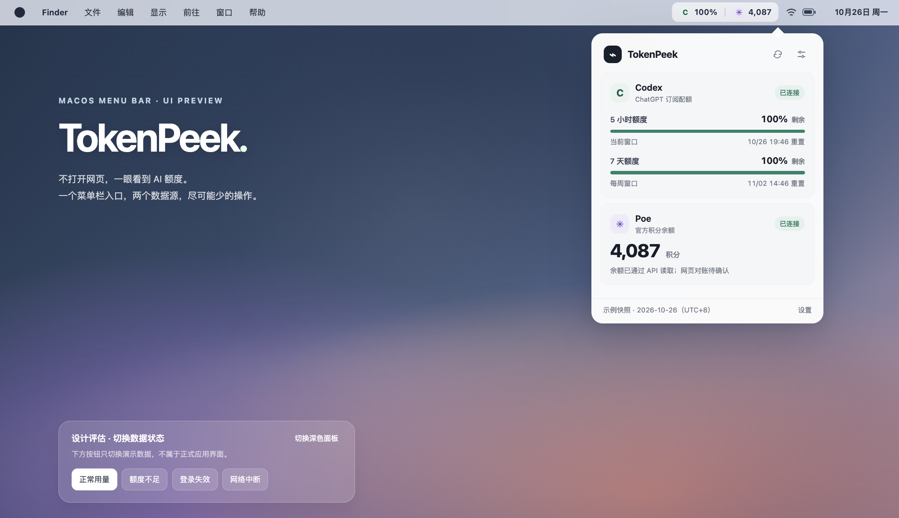

# TokenPeek


TokenPeek 是一个只驻留在 macOS 菜单栏的本地额度查看工具。它通过本机已登录的 Codex CLI App Server 读取 Codex 配额，并通过 Poe 官方 Usage API 读取积分余额。

## 构建

```bash
chmod +x scripts/build-app.sh
./scripts/build-app.sh
open dist/TokenPeek.app
```

要求 macOS 14 或更高版本、Swift 6 工具链，以及已安装并登录的 Codex CLI。Poe API Key 在应用设置中输入，只保存在 macOS 钥匙串。

## 数据与安全

- Codex：启动本机 `codex app-server --stdio`，调用只读的 `account/rateLimits/read`。
- Poe：调用官方 `GET https://api.poe.com/usage/current_balance`。
- 敏感数据：Poe API Key 使用 Keychain 保存；不会写入缓存或日志。
- 缓存：仅保存上次成功的非敏感用量快照；失败时明确标记为过期。
- 刷新：默认 5 分钟；连续失败后退避，最长 30 分钟。
